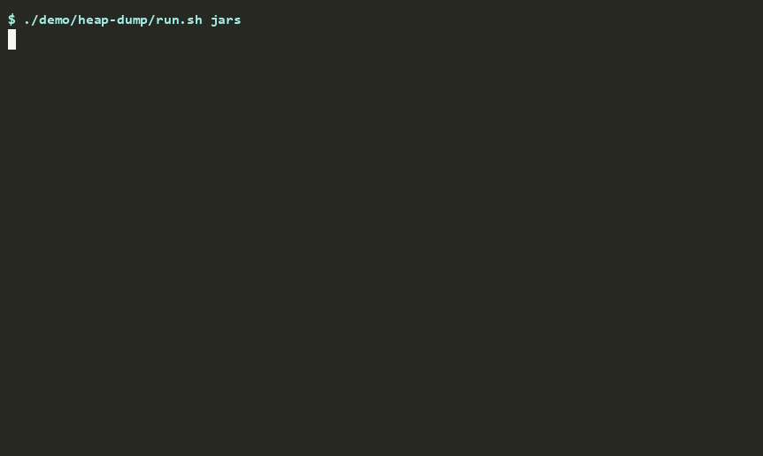

# seclume

**Java heap dumps without secrets.**

Every heap dump of a Java application contains the credentials it logs in with: the database
password, the mail password or OAuth token, the API keys and signing keys, the MongoDB, Kafka and Redis logins. `jmap`,
`-XX:+HeapDumpOnOutOfMemoryError`, the Actuator's `/heapdump`, the file attached to a support
ticket. It does not matter that the password came from Vault. The moment the client library
turns Vault's answer into a `String` and keeps it, it is on the heap, and the heap is what
gets dumped.

seclume is a set of clients built so that this does not happen: JDBC drivers for PostgreSQL,
MySQL/MariaDB, SQL Server and Oracle, a MongoDB driver, and clients for Elasticsearch and
OpenSearch, Kafka, RabbitMQ, NATS, Redis, mail (SMTP, IMAP, POP3) and HTTPS APIs. Each logs
in from native memory, and the credential never becomes a heap object:

```
            the usual stack                          seclume

  Vault                                    Vault
    |                                        |
    v                                        v
  password -> java.lang.String             native memory (locked, wiped after use)
    |                                        |
    v                                        v
  JDBC driver                              seclume JDBC driver
    |                                        |
    v                                        v
  heap dump  ->  FOUND: the password       heap dump  ->  NOT FOUND
```

**Don't take our word for it. Check it.** [`demo/heap-dump`](demo/heap-dump) runs the same
small application twice against PostgreSQL and a Vault dev server, once with pgjdbc and
once with seclume, dumps both heaps and searches them. This is its output, unedited:



As text:

```
== pgjdbc - the password from Vault as a String
  database password:
    FOUND - the secret is in the heap of process 26, 2 time(s):
      raw file: UTF-8 match of 31 bytes at 8175627
      byte[] 30308835136: UTF-8 match of 31 bytes at 132
  Vault token:
    FOUND - the secret is in the heap of process 26, 2 time(s):
      raw file: UTF-8 match of 31 bytes at 8179605
      byte[] 30308837096: UTF-8 match of 31 bytes at 0

== seclume - the password from Vault into native memory
  database password:
    NOT FOUND - the secret from /shared/db-password is not in the heap of process 46.
  Vault token:
    NOT FOUND - the secret from /shared/vault-token is not in the heap of process 46.
```

And for **your own application**, whatever driver it uses:

```
java -jar seclume-heapcheck.jar --pid <pid> --secret-file /run/secrets/db-password
```

It attaches to the running JVM, takes a dump, searches it for the secret in every encoding it
could be in, and deletes the dump again. The secret comes from a file, never from the command
line. For audits it also checks existing dumps and several secrets at once, and writes a
Markdown or JSON report: `--dump`, `--secret-dir`, `--report`. And `--discover` finds what
nobody named - private keys, JWTs, cloud and platform tokens, passwords in URLs - by their
shape, reporting which kind, how often and where, never the value. `--redact copy.hprof`
writes a copy of the dump with all of that overwritten and checked again, for a dump that has
to leave the house. `kubectl seclume heapcheck <pod>` runs the check inside a pod, beside the
JVM, and brings back only the report; `kubectl seclume redact <pod> -o copy.hprof` brings back only
a redacted dump. `--watch <dir>` redacts the dumps `-XX:+HeapDumpOnOutOfMemoryError` leaves, as
they are written; the Spring Boot starter does it in the application itself.

For CI, `--report heapcheck.sarif` adds SARIF output. A ready-to-use GitHub Action
and a comparison of successive JSON reports are in [DIAGNOSTICS.md](DIAGNOSTICS.md).
`seclume-verify --doctor [--pool-size N] "<jdbc url>"` checks native memory protection,
the actual TLS connection, certificate settings and database capacity, with advice
for each finding; add `--json` for automation.

### How

A password or token never becomes a `String`, a `char[]` or a `byte[]`. It goes from its
source (a file, Vault, a cloud secret manager, a managed identity) into native memory, is used
there for the login, and is wiped. All four database wire protocols, the SMTP, IMAP and POP3
logins and the HTTP client are
written from scratch for this; no vendor driver is used, wrapped or delegated to. Redis, mail
and HTTP always encrypt with seclume's own TLS 1.3, and the databases with seclume's own TLS -
1.3, or a small TLS 1.2 profile for a server without it - so the session keys stay off the heap
as well. The test suite holds the same line by taking
real heap dumps and searching them, with a negative control that must fail.

Beyond that it is a complete driver set for everyday use: a pool, a Spring Boot starter,
TLS 1.3 by default, and Kerberos and OAuth logins with no secret in the process at all. It is
measured against the vendor drivers with the same settings on both sides, including the rows
where it is behind ([Speed](#speed)). See [Features at a glance](#features-at-a-glance).

Java 25, Spring Boot 4.x / Spring Framework 7.x. No runtime dependency beyond the JDK.

**Contents:** [Quick start](#quick-start) · [What you get without configuring anything](#what-you-get-without-configuring-anything) ·
[Features at a glance](#features-at-a-glance) · [Not yet](#what-it-does-not-do-yet) ·
[Speed](#speed) · [Building](#building-and-testing) · [Support](#support-and-what-you-may-rely-on)

OpenSSF best practices assessment:
[](https://www.bestpractices.dev/en/projects/15186)
[](https://central.sonatype.com/namespace/space.seclume)

---

## Quick start

```xml
<dependency>
  <groupId>space.seclume</groupId>
  <artifactId>seclume-spring-boot-starter</artifactId>
  <version>0.13.1</version>
</dependency>
<dependency>
  <groupId>space.seclume</groupId>
  <artifactId>seclume-postgresql</artifactId>   <!-- or -mysql, -sqlserver, -oracle -->
  <version>0.13.1</version>
</dependency>
```

```properties
seclume.datasources.main.url=jdbc:seclume:postgresql://db:5432/app?tls=verify-full
seclume.datasources.main.username=app
seclume.datasources.main.secret-uri=file:/run/secrets/db-password
```

That is the whole integration. Spring gets a pooled `DataSource`, and Spring Data, Hibernate
and Flyway work on it as they would on any other.

**Five minutes, end to end:** [examples/getting-started](examples/getting-started) runs this
with PostgreSQL and Vault in Docker. It then shows with a heap dump of each that the usual
way leaves the password in the heap and seclume does not.

Releases are on **Maven Central** from 0.13.1 on: no repository entry and no token are needed.
Every file is signed with the release key in [SECURITY.md](SECURITY.md#verifying-a-release).
`seclume-bom` keeps the versions of all modules in step.

Without Spring, the same thing as a URL:

```java
String url = "jdbc:seclume:postgresql://db:5432/app"
           + "?user=app&provider=file&path=/run/secrets/db-password";
try (Connection c = DriverManager.getConnection(url)) {
    // plain JDBC from here
}
```

The URL prefix is `jdbc:seclume:`. There is one artifact per database: `seclume-postgresql`,
`seclume-mysql`, `seclume-sqlserver` and `seclume-oracle`. There are also `seclume-pool` and
`seclume-spring-boot-starter`, and the starter pulls in what it needs. The groupId and the
package root are the same, `space.seclume`.

**Coming from HikariCP, pgjdbc, Connector/J, mssql-jdbc or ojdbc?**
`java -jar seclume-verify.jar --migrate application.properties` translates your configuration,
and **[MIGRATING.md](MIGRATING.md)** lists the errors that stop happening, each with the test
that shows it.

**Where the secret comes from** is a provider, never a value. A secret is never a setting,
and `password=` is refused. The providers are `file`, `env-file`, `process`, `unix-socket`,
`dpapi`, `credential-manager`, `encrypted`, `rds-iam`, `vault` (including dynamic database
credentials, and logging in by Kubernetes, JWT or AppRole), `aws-secrets-manager`, `azure-key-vault`, `gcp-secret-manager`,
`azure-managed-identity`, `gcp-metadata`, `spiffe-jwt` (a SPIFFE JWT-SVID), `none` (the client
certificate is the login), and
`callback` for your own code. **[PROVIDERS.md](PROVIDERS.md)** has every setting of every
provider and says which one to pick.

---

## What you get without configuring anything

The quick start above already gives you:

- **No password on the heap**, in a page that is locked against swapping, left out of crash
  dumps, and wiped after use.
- **Expiring credentials handled by the pool.** A Vault lease or an RDS token is replaced
  before it runs out, so nothing fails an hour later.
- **A clean connection for every borrower.** A `SET app.tenant_id`, a temporary table or a
  `LISTEN` from one request does not reach the next one.
- **Statements a borrower forgot are closed** on return, and logged with where they came
  from.
- **A shutdown that lets running transactions finish.** On SIGTERM, borrowed connections get
  up to 10 s to come back before anything is cut.
- **A result limit.** A runaway query fails on its own instead of taking the heap with it.
- **Idle connections that stay alive**, below the server's own idle limit (`wait_timeout`,
  `idle_session_timeout`) and through firewalls. If something cuts one anyway, the error
  names the cause.
- **A warning when the pool could exhaust the server's connection limit**, before the
  scale-out that would find out.
- **A startup report of plaintext passwords elsewhere** in the Spring configuration, naming
  the properties and never the values.

What is left to decide is `tls=`: whether to authenticate the server
([TLS.md](TLS.md)).

---

## Features at a glance

Everything below works on all four databases unless the row says otherwise.

| Area | What | More |
|---|---|---|
| **Secrets** | 19 providers plus `none` and `callback`: files, Windows DPAPI/Credential Manager, the Linux and macOS keyrings, Vault, AWS/Azure/GCP vaults, RDS IAM, workload identity (VMs, App Service, Arc, Kubernetes, GCP, SPIFFE JWT-SVIDs) | [PROVIDERS.md](PROVIDERS.md) |
| | Dynamic credentials: the driver logs in as the user Vault created, the lease is renewed and revoked at the end; the pool rotates connections before it runs out, without emptying | [PROVIDERS.md](PROVIDERS.md#what-expires-buys) |
| | Secret columns read and bound off the heap (`Sensitive`, `SensitiveParameters`) | [FEATURES.md](FEATURES.md#secrets-in-columns-not-only-in-the-login) |
| | Field encryption: columns encrypted in the application with AES-256-GCM-SIV, randomized or searchable, keys off the heap and best opened by Vault transit or a cloud KMS; the same format on every JDBC driver; JPA converters and a `Sealed` type (`seclume-jpa`), the key ring from `application.properties` | [ENCRYPTION.md](ENCRYPTION.md) |
| **TLS** | `verify-full`, a per-connection CA file (`tlsRootCert`) or a key pin (`tlsPin`) | [TLS.md](TLS.md) |
| | Own TLS 1.3 stack: traffic secrets never become Java objects; post-quantum X25519MLKEM768 with OpenSSL 3.5 or Windows CNG | [TLS.md](TLS.md#which-tls-carries-it-a-separate-question) |
| | Client certificates with the key off the heap, in the Windows store or in a TPM | [TLS.md](TLS.md#mutual-tls-with-the-client-key-off-the-heap-too) |
| | SQL Server strict encryption (TDS 8.0), PostgreSQL 17 direct TLS | [TLS.md](TLS.md) |
| **JDBC** | The full surface: callable statements, named parameters, generated keys, batches, LOBs, scrollable results, XA | [FEATURES.md](FEATURES.md#the-jdbc-surface-on-all-four) |
| | Cancellation and timeouts that stop the statement on the server | [FEATURES.md](FEATURES.md#the-jdbc-surface-on-all-four) |
| | `where id in (?)` with a whole list: one plan, no 1000/2100 limit | [FEATURES.md](FEATURES.md#writing-retrying-and-not-guessing) |
| | SQL Server: `varchar` parameters where the column is `varchar`, so the index is used; bulk load (`INSERT BULK`); table-valued parameters | [FEATURES.md](FEATURES.md#sql-server-only) |
| | `Pipeline`: a unit of work in one round trip | [FEATURES.md](FEATURES.md#writing-retrying-and-not-guessing) |
| | `Retry` for serialization failures and deadlocks; a lost commit reported as unknown, never retried | [FEATURES.md](FEATURES.md#writing-retrying-and-not-guessing) |
| | PostgreSQL: arrays, XML, large objects, LISTEN/NOTIFY, `COPY` bulk import/export, PgBouncer; CockroachDB, YugabyteDB | [FEATURES.md](FEATURES.md#postgresql-only) |
| **Pool** | No dependency, virtual threads, statement cache, leak detection | [FEATURES.md](FEATURES.md#the-pool) |
| | Session reset on return (the tenant leak), open statements closed | [FEATURES.md](FEATURES.md#the-pool) |
| | The tenant set on every borrow for row-level security (`SessionContext`) | [FEATURES.md](FEATURES.md#the-pool) |
| **Clusters** | Host lists, `targetServerType=primary`, `hostSelection=quality` | [FEATURES.md](FEATURES.md#several-servers-and-which-one-to-take) |
| | Read replicas with `ReadWriteSplit`, read-your-writes on PostgreSQL | [FEATURES.md](FEATURES.md#several-servers-and-which-one-to-take) |
| **Frameworks** | Spring Data JPA, Hibernate, Flyway, Liquibase, jOOQ, MyBatis, Spring Data JDBC, all tested on all four | [FRAMEWORKS.md](FRAMEWORKS.md) |
| **MongoDB** | seclume's own driver behind the official `com.mongodb.client` API (sessions, transactions, change streams, replica sets, sharding and load balancers, `mongodb+srv`, compression, GridFS, Search indexes), a reactive API, and Spring Data MongoDB on both; SCRAM, X.509, AWS and OIDC logins off the heap: `seclume-mongodb-driver`, `seclume-mongodb-reactive` | [FEATURES.md](FEATURES.md#mongodb) |
| | The official MongoDB driver on a pre-authenticated socket, for code that has to keep it: `seclume-mongodb` | [FEATURES.md](FEATURES.md#mongodb) |
| **Spring Boot** | MongoDB, Elasticsearch, OpenSearch, RabbitMQ, NATS and Redis from one property each; Spring Boot's own password settings refused at start: `seclume-spring-boot-starter` | [FEATURES.md](FEATURES.md#spring-boot-data-services-from-applicationproperties) |
| **R2DBC** | A reactive driver over the four, with each database's own placeholders; R2DBC's conformance suite passes; over the pool and its reset, Spring Boot's `ConnectionFactory` when it is on the class path: `seclume-r2dbc` | [FEATURES.md](FEATURES.md#r2dbc) |
| | Testcontainers `@ServiceConnection` and Docker Compose: the pool comes from the container | [FEATURES.md](FEATURES.md#spring-data-and-jpa) |
| **Observability** | JFR events, Micrometer meters, OpenTelemetry spans and metrics (`seclume-opentelemetry`, no Micrometer needed), all without values - for the databases and every module: logins, secrets written into requests, signatures, rotations | [OBSERVABILITY.md](OBSERVABILITY.md) |
| | `/actuator/seclume`: login method, TLS, certificate expiry and server capacity per data source | [OBSERVABILITY.md](OBSERVABILITY.md#actuatorseclume-how-every-data-source-is-secured) |
| | `/actuator/heapdump`: a redacted copy of the heap - the credentials it finds overwritten - never the heap itself | [OBSERVABILITY.md](OBSERVABILITY.md#actuatorheapdump-a-redacted-copy-never-the-heap-itself) |
| | `/actuator/cbom` and `seclume-verify --cbom`: the cryptography the application uses - secrets, keys, TLS sessions, certificates, algorithms with their NIST quantum security level - as a CycloneDX 1.6 CBOM, never a value | [OBSERVABILITY.md](OBSERVABILITY.md#actuatorcbom-the-cryptography-the-application-uses) |
| | N+1 detection (`QueryStorms`), the last messages before a break (`Flight`) | [OBSERVABILITY.md](OBSERVABILITY.md#diagnostics-for-specific-defects) |
| **Tools** | `seclume-verify`: a one-shot connection report, for a ticket or a readiness probe | [OBSERVABILITY.md](OBSERVABILITY.md#seclume-verify) |
| | `seclume-verify --migrate`: your Hikari/pgjdbc/mssql-jdbc configuration translated, unsafe settings named | [OBSERVABILITY.md](OBSERVABILITY.md#seclume-verify) |
| | `NoSecretInHeap`: the heap-dump proof in your own tests; `seclume-heapcheck` for any process |
| | `seclume-heapcheck --redact`: a copy of a heap dump with every credential it finds overwritten, to hand on; the library behind it is `seclume-heapdump` | [DIAGNOSTICS.md](DIAGNOSTICS.md#a-dump-to-hand-on---redact) |
| | Log lines with the application's own secrets masked before they are written - a Logback converter for message and stack trace, the masker holding keyed fingerprints, never a secret: `seclume-logging` | [DIAGNOSTICS.md](DIAGNOSTICS.md#log-lines-the-applications-secrets-masked-before-they-are-written) |
| | `seclume-admission`: a Kubernetes webhook that gives annotated pods a dump folder with a redacting sidecar and the SPIFFE socket | [DIAGNOSTICS.md](DIAGNOSTICS.md#injected-by-annotation-the-admission-webhook) |
| **Your own library** | `seclume-core`'s secret classes for any client that holds a secret: mail, API keys, signing keys | [SECRETS-API.md](SECRETS-API.md) | [FEATURES.md](FEATURES.md#proving-there-is-no-secret-on-the-heap-for-any-application) |
| **Kafka** | SASL/SCRAM, PLAIN and OAUTHBEARER with the password or token off the heap, PLAIN and OAUTHBEARER over seclume's own TLS 1.3: `seclume-kafka` | [FEATURES.md](FEATURES.md#kafka) |
| **Redis** | Jedis and Lettuce logged in from native memory, over TLS 1.3 with keys off the heap, Cluster and Sentinel included: `seclume-redis` | [FEATURES.md](FEATURES.md#redis) |
| **NATS** | The official client with the NKey seed, `.creds` file, password or token off the heap, over TLS 1.3: `seclume-nats` | [FEATURES.md](FEATURES.md#nats) |
| **Elasticsearch / OpenSearch** | The official clients (Elasticsearch 9/8, OpenSearch 3, Amazon OpenSearch with SigV4) with the API key, token or password written into each request from native memory: `seclume-elasticsearch` | [FEATURES.md](FEATURES.md#elasticsearch-and-opensearch) |
| **Mail** | Sending (SMTP) and reading (IMAP, POP3), logged in with PLAIN, LOGIN or XOAUTH2 from native memory over STARTTLS or implicit TLS 1.3; a Jakarta Mail session for Spring's `JavaMailSender`, Spring Integration and Camel: `seclume-mail` | [FEATURES.md](FEATURES.md#mail) |
| **HTTPS APIs** | API keys, bearer tokens and Basic passwords written from native memory, per request and only to their own origin; standalone or as the request factory for Spring's `RestClient` and `RestTemplate`: `seclume-http` | [FEATURES.md](FEATURES.md#https-apis) |
| **Signing keys** | JWTs signed and checked with HMAC keys, signed with RSA or EC keys held by OpenSSL (Linux) or CNG (Windows); GitHub and Stripe webhook signatures checked: `seclume-jwt` | [FEATURES.md](FEATURES.md#signing-keys-jwt-and-webhooks) |
| **RabbitMQ** | A `ConnectionFactory` for the official client and Spring AMQP; the PLAIN login written from native memory into the handshake over TLS 1.3, also on recovery: `seclume-rabbitmq` | [FEATURES.md](FEATURES.md#rabbitmq) |
| **Private keys** | TLS server keys (Tomcat, Netty, any `SSLContext`), client certificates and Spring SSL bundles with the key held by OpenSSL (Linux) or CNG (Windows), client certificates from Vault's PKI for a key made in OpenSSL, SPIFFE X.509-SVIDs from the Workload API, keys that never leave Vault transit, AWS KMS, Cloud KMS or Key Vault (`kms=`): `seclume-keys` | [FEATURES.md](FEATURES.md#private-keys-tls-servers-client-certificates-ssh) |
| **SSH / SFTP** | Public-key logins for Apache MINA SSHD, Spring Integration SFTP and JSch with that key - Ed25519, ECDSA, RSA, also from OpenSSH key files: `seclume-ssh` | [FEATURES.md](FEATURES.md#private-keys-tls-servers-client-certificates-ssh) |
| **AWS** | A SigV4 signer for the AWS SDK (S3, SQS, DynamoDB, MinIO ...) with the secret access key in native memory; temporary credentials (EC2, ECS/EKS, IRSA) with the session token off the heap too; presigned S3 URLs; SigV4a for multi-region access points: `seclume-aws` | [FEATURES.md](FEATURES.md#aws) |
| **Azure Storage** | Shared Key signing for Blob, Queue, File and Data Lake with the account key in native memory: `seclume-azure` | [FEATURES.md](FEATURES.md#azure-storage) |
| **Google Cloud** | Service account credentials whose private key stays in OpenSSL, for every Google Cloud library: `seclume-gcp` | [FEATURES.md](FEATURES.md#google-cloud) |
| **Kubernetes** | The official Java client with the service account token off the heap, rotation included: `seclume-kubernetes` | [FEATURES.md](FEATURES.md#kubernetes-git-and-grpc) |
| **Git** | JGit over HTTPS with the password or token off the heap: `seclume-jgit` | [FEATURES.md](FEATURES.md#kubernetes-git-and-grpc) |
| **gRPC** | Bearer tokens and API keys written into HTTP/2 header blocks from native memory: `seclume-grpc` | [FEATURES.md](FEATURES.md#kubernetes-git-and-grpc) |
| | Any HTTP client that takes an `SSLSocketFactory` (OkHttp, `HttpsURLConnection`): `SeclumeSslSocketFactory` in `seclume-http` | [FEATURES.md](FEATURES.md#kubernetes-git-and-grpc) |
| **LDAP / Active Directory** | JNDI, Spring LDAP and Spring Security binds with the password written from native memory over TLS 1.3: `seclume-ldap` | [FEATURES.md](FEATURES.md#ldap-and-active-directory) |
| **Rotation** | Passwords, TLS server keys and certificates rotated at their source, taken up without a restart; a JFR event and a metric for each rotation | [FEATURES.md](FEATURES.md#rotation-without-a-restart) |
| **Runtime** | GraalVM native image, no flags needed | [FEATURES.md](FEATURES.md#graalvm-native-image) |
| | Quarkus, JVM and native: the four drivers as datasource kinds; a password in the configuration fails the build: `seclume-quarkus` | [FEATURES.md](FEATURES.md#quarkus) |
| | CRaC / Lambda SnapStart with `seclume-crac`: the checkpoint image holds no password | [FEATURES.md](FEATURES.md#the-pool) |

### Supported database versions

| Database | Supported | Not (yet) |
|---|---|---|
| PostgreSQL | 9.6 to 18 | - |
| SQL Server | 2017 to 2025 | 2016 untested (no Linux image); 2008 R2 and older (TDS 7.3) |
| Oracle | 18c to 23ai; 11g with `legacyVerifier=11g` | 12c and 19c untested (no public image) |
| MySQL / MariaDB | MySQL 8.4, MariaDB 11.4 and 11.8 | older versions untested |
| CockroachDB, YugabyteDB | 24.1, 2024.1 | - |

Each version was run as a container against the driver's whole test suite - the protocol, what
was found and what remains is in [SUPPORTED-VERSIONS.md](SUPPORTED-VERSIONS.md). What each
server version reports is in [COMPATIBILITY.md](COMPATIBILITY.md), generated by connecting to
it. The full history is in [CHANGELOG.md](CHANGELOG.md).

---

## What it protects, and what it does not

seclume makes one artefact safe: **the heap dump**. Heap dumps are taken routinely, by
`-XX:+HeapDumpOnOutOfMemoryError`, by an Actuator endpoint left open, by a support engineer.
They are copied to buckets, tickets and laptops. Today they carry the database password
wherever they go. With seclume they do not carry the password, and they do not carry a
token, a Vault token read by a seclume provider, or a client certificate's private key either.

It does **not** make the process a vault:

- **Your data is still on the heap.** Rows you read and parameters you bind are Java objects,
  as with any driver. Columns that hold secrets can be read and bound off the heap
  (`Sensitive`, `SensitiveParameters`), but that is opt-in, per column.
- **Every server gets seclume's own TLS, never the JDK's by surprise.** TLS 1.3 where the
  server has it, and a small TLS 1.2 profile (ECDHE, AES-GCM, extended master secret) where it
  does not - SQL Server's TDS 7.4, PostgreSQL 9.6 to 11 on an older OpenSSL, any server held
  to TLS 1.2. A server that speaks neither is
  refused; `tlsStack=jsse` reaches it, and then the session keys are on the heap, and so,
  briefly, is what JSSE decrypts: the JDK's AES-GCM passes direct buffers through short-lived
  heap arrays, which matters for a login that goes in clear text inside TLS (PostgreSQL
  `password`, MySQL's full `caching_sha2_password`, SQL Server's Login7). The own stack is
  newer and has had less scrutiny than JSSE. See
  [TLS.md](TLS.md#which-tls-carries-it-a-separate-question).
- **Other secrets in your application are yours.** An API key in `application.yml` is on the
  heap whatever driver you use. The starter warns about plaintext passwords it can see, and
  `seclume-heapcheck` finds any secret you name in a running process.
- **Someone who can read the process's memory, or the secret's source, has the secret.**
  Root, `ptrace` or `/proc/<pid>/mem` read native memory as well. What seclume does narrow
  is *when*: once a login is done, the password is nowhere in the process - not in the heap
  and not in native memory, which `ProcessMemoryTest` checks by reading all of it. During a
  login it is. Someone who can read
  `/run/secrets/db` or the Vault token does not need a dump. seclume closes the leak through
  the dump, not a compromised host.

Where you can, log in **without a secret at all**: Kerberos (PostgreSQL, MariaDB, SQL Server, Oracle),
Oracle's Windows-native login (NTS), short-lived
IAM or Entra tokens, or PostgreSQL 18 OAuth. seclume supports those too. And lock down the
heap-dump endpoints anyway.

## What it does not do yet

- **Moving a live session from one host to another.** It is being built, but not here. The
  drivers hold their own protocol and TLS state, which is exactly what such a move needs and
  what no driver built on an `SSLEngine` can offer. So this repository carries the seams it
  takes: a logged-in stream can be handed over (`detach`), described while it stays open
  (`snapshot`), and picked up again (`resume`). What happens between those ends is developed
  separately and is not part of this distribution. When it is finished, what will be
  published here is the **evidence**, not the code.

---

## Speed

The aim is not "fast enough" but faster than the established Java drivers. The rows come
from JMH runs, written to [BENCHMARKS.md](BENCHMARKS.md#all-four-databases-13102026)
together with the machine, the JDK and every iteration: a quiet Linux host with 4 cores, the
benchmark pinned to two of them, each database in a container on the same machine and TLS on
every connection, so it shows what the driver costs rather than what the network does.

Each cell is **seclume / the vendor driver** (HikariCP over the vendor driver for the pool
rows). The bracket is seclume's time against it - **−12 %** is 12 % less time - and "even"
means the error bars overlap.

| | PostgreSQL | MySQL | SQL Server | Oracle |
|---|---|---|---|---|
| `select 1` | 46 µs / 53 µs (**−12 %**) | 41 µs / 49 µs (**−15 %**) | 86 µs / 92 µs (even) | 37 µs / 61 µs (**−39 %**) |
| one row | 42 µs / 42 µs (even) | 42 µs / 52 µs (**−21 %**) | 92 µs / 93 µs (even) | 40 µs / 40 µs (even) |
| 1000 rows | 728 µs / 696 µs (even) | 708 µs / 950 µs (**−25 %**) | 10.5 ms / 10.3 ms (even) | 932 µs / 1.2 ms (**−20 %**) |
| insert one row | 0.67 ms / 0.67 ms (even) | 6.14 ms / 7.14 ms (even) | 1.58 ms / 1.58 ms (even) | 2.17 ms / 2.27 ms (even) |
| batch of 500, as they come | 2.99 ms / 3.04 ms (even) | 17.96 ms / 32.89 ms (**−45 %**) | 9.24 ms / 9.44 ms (even) | 1.43 ms / 1.57 ms (even) |
| batch of 500, both rewriting | 1.53 ms / 1.51 ms (even) | 5.04 ms / 7.13 ms (even) | 9.37 ms / 9.35 ms (even) | 1.43 ms / 3.80 ms (even) |
| pool: borrow and return | 0.42 µs / 0.66 µs (**−36 %**) | 0.44 µs / 0.53 µs (**−17 %**) | 0.46 µs / 0.60 µs (**−24 %**) | 0.44 µs / 0.51 µs (**−15 %**) |
| pool: borrow, prepared query, return - no reset | 108 µs / 110 µs (even) | 128 µs / 139 µs (even) | 300 µs / 309 µs (even) | 105 µs / 169 µs (**−38 %**) |
| pool: borrow, prepared query, return - seclume resets the session | 263 µs / 110 µs (+138 %) | 272 µs / 139 µs (+95 %) | 325 µs / 309 µs (even) | 17.4 ms / 169 µs (103× the time) |
| the same, 4 threads with 2 ms between requests | 166 µs / 113 µs (+47 %) | 159 µs / 122 µs (+30 %) | 234 µs / 220 µs (+6 %) | 6.5 ms / 132 µs (49× the time) |

**How to read the pool rows.** HikariCP hands a connection back as it is. seclume's pool over
seclume's driver resets the session on every return, so the next borrower cannot see the last
one's temporary tables, session variables, settings or prepared statements; on Oracle it logs
the session off and on again. That reset is the difference in the last two rows: free on SQL
Server, one round trip on PostgreSQL and MySQL, and on Oracle a login that Oracle Free cannot
keep up with when eight threads borrow without a pause. The same pool without the reset is
the row above them. Why the reset is not optional: [SECURITY.md](SECURITY.md).

**How to read the batch rows.** Connector/J sends a batch row by row unless
`rewriteBatchedStatements=true` is set, and seclume pipelines the rows. That is the first
batch row, and it compares defaults. With both drivers told to rewrite a batch into
multi-row inserts (seclume: `rewriteBatchedInserts=true`), **neither is ahead**. An earlier
version of this table compared seclume against Connector/J's default alone. That flattered
seclume, and an outside review said so.

Only rows recorded in BENCHMARKS.md are shown here. Figures measured without a recorded run
(over a LAN, with PostgreSQL and eight threads, or counted in round trips) were removed until
they are recorded. **The rows where the vendor side is ahead are left in deliberately.** A
table that only listed the wins would be advertising.

To reproduce a run:

```
java -Dbench.db=mysql -Dbench.host=<host> -Dbench.port=3306 -Dbench.database=seclume_test -Dbench.user=seclume_test -Dbench.password.file=.local-mysql-password -jar seclume-bench/target/seclume-bench.jar QueryBenchmark -rf json -rff jmh.json
```

---

## Building and testing

```
./mvnw clean test
```

Everything that needs no database runs; everything that needs one skips itself and says why.
`-Papicheck verify` compares the public API with the last release, and `-Prelease package`
writes a CycloneDX SBOM per module (`seclume-core` lists no runtime dependency at all).
[TESTING.md](TESTING.md) explains how to bring the four databases up and how to point the
tests at servers elsewhere. On every push, CI runs the same suite against PostgreSQL 15 and
18, MySQL 8.4, MariaDB 11.4, SQL Server 2022, Oracle Free 23ai, CockroachDB 24.1 and
YugabyteDB 2024.1. The four wire parsers are fuzzed: a sample runs in every build, and the
whole corpus runs nightly.

## Where the protocol knowledge came from

Three of the four protocols have published specifications and were implemented from them.
The fourth, Oracle, has none. The largest single source there is Oracle's own driver, under a
licence that permits reimplementation. No vendor source was used, no headers, and nothing was
decompiled: [PROVENANCE.md](PROVENANCE.md).

## Rules of honesty

- No placeholder that pretends to work. What is not implemented throws.
- No provisional delegation to a vendor driver, not even commented out.
- A protocol detail that cannot be established with certainty counts as unsupported rather
  than being guessed.
- Test results are reported with their output. "Should work" does not count.

## Support, and what you may rely on

For bug reports, feature requests and pull requests, see
[CONTRIBUTING.md](CONTRIBUTING.md). Report suspected vulnerabilities privately
through the process in [SECURITY.md](SECURITY.md).
The threat model is [THREAT-MODEL.md](THREAT-MODEL.md); seclume has not been reviewed externally
yet, and [AUDIT.md](AUDIT.md) is the guide for whoever does.

seclume is written and maintained by one person, in the time that person has. It is used in
earnest, it is kept working, and issues do get read. But there is **no company behind it, no
support contract, and no promise that anything is answered within any particular time, or at
all**. Nor is there a promise of a next release. Please plan as though the version you are
using now is the last one you will get. If a later one arrives, treat it as a gift rather than
as the plan.

That matters more than usual here, because this is a **driver**, the piece everything else
sits on. So it is built to be survivable without its author:

- The **licence is Apache-2.0**, so you may keep using, patching and shipping what is here,
  whatever happens to this project.
- **Nothing is hidden.** Every byte on the wire is written in this repository. There is no
  vendor driver underneath to fall back to and no service to call home to.
- The **tests are the specification**, and they run against real PostgreSQL, MySQL, MariaDB,
  SQL Server and Oracle servers. They are the thing to read first if you ever have to take
  this over, and the reason you could.
- **Security reports** are taken seriously and handled as fast as one person can, which is
  not the same as an SLA.

If seclume matters to something you are paid to keep running, budget for owning it rather than
for being supported. That is the honest arrangement, and saying so up front seems better than
letting anyone find out at the wrong moment.

## Licence

Apache License 2.0; see [LICENSE](LICENSE) and [NOTICE](NOTICE). You may use it commercially,
modify it, and ship it inside a closed product. The licence grants the patent rights along
with the copyright ones, which for a project full of protocol implementations is the part that
matters.

The transport that moves a live session between hosts is **not** part of this repository, is
not covered by that licence, and no rights to it are granted here.
